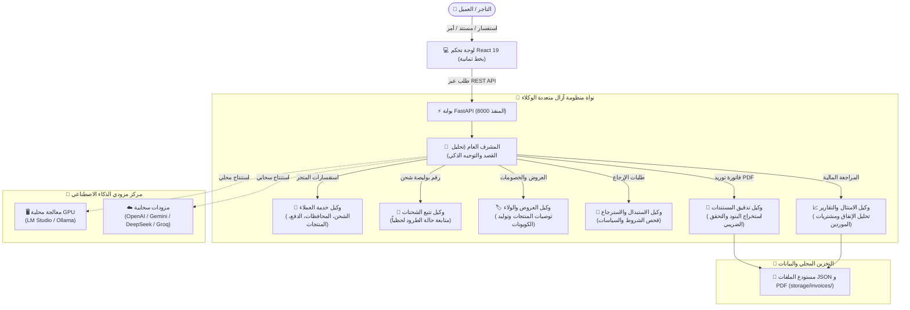
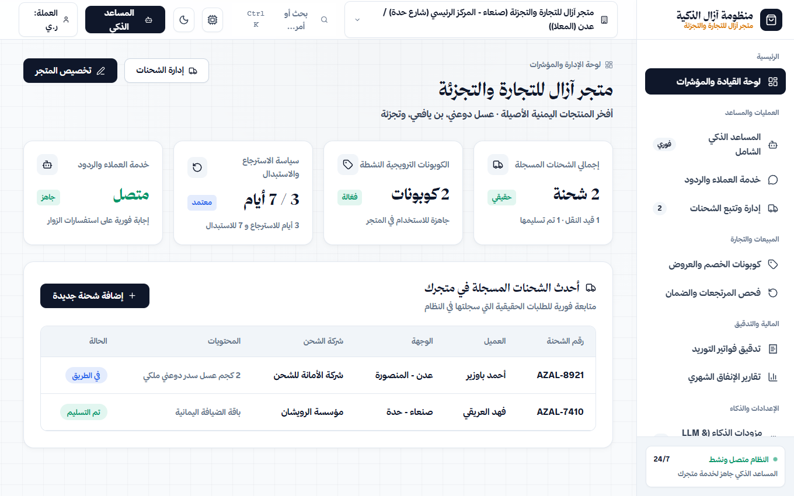
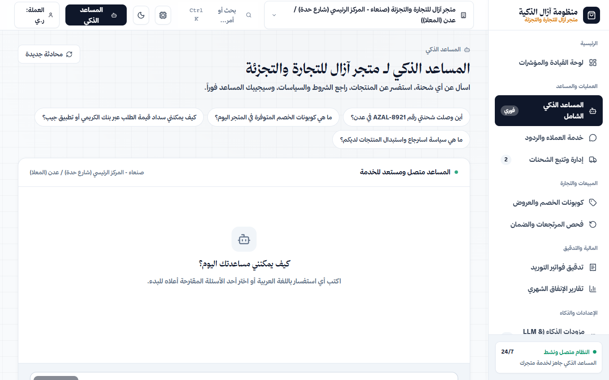
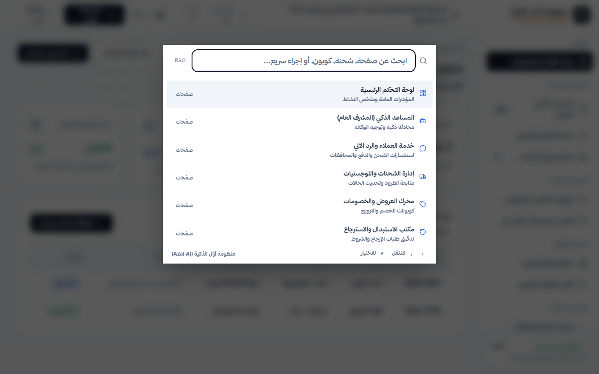
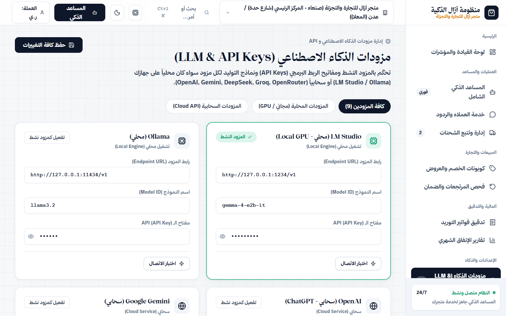
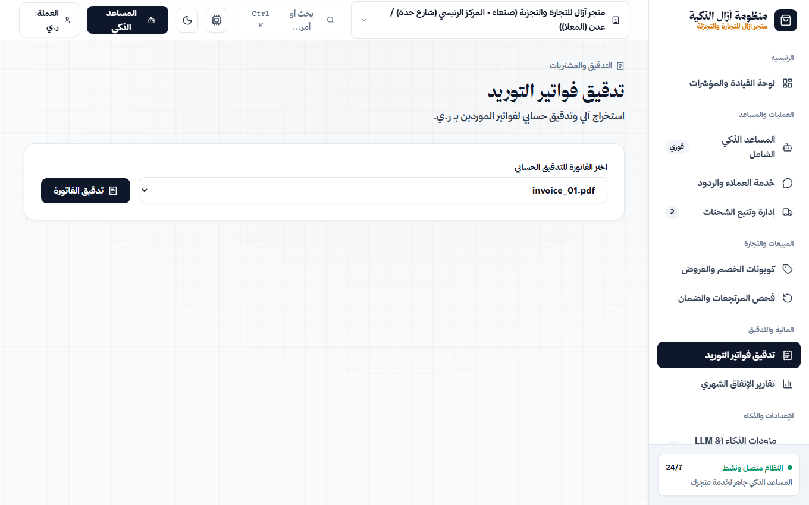
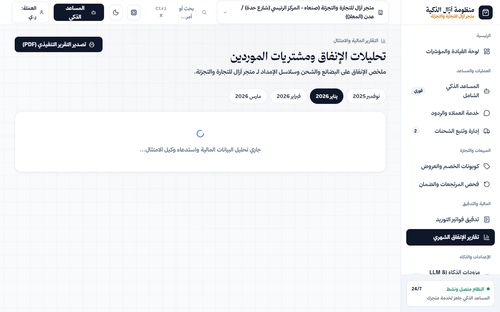

<div align="center" dir="rtl">

# ⚡ منظومة آزال الذكية (Azal AI)
### *نظام تشغيل ذكاء اصطناعي متعدد الوكلاء لإدارة التجارة الإلكترونية والتجزئة الحديثة*

[](https://fastapi.tiangolo.com)
[](https://react.dev)
[](https://www.typescriptlang.org)
[](https://vitejs.dev)
[](https://www.python.org)
[](https://lmstudio.ai)
[](LICENSE)

<br/>

**[ 🇬🇧 Read in English (English README) ](README.md)** &nbsp;|&nbsp; **[ 📑 جدول المحتويات ](#-جدول-المحتويات)** &nbsp;|&nbsp; **[ 🚀 التشغيل السريع ](#-التشغيل-السريع)** &nbsp;|&nbsp; **[ 🌟 ادعم المشروع بنجمة على GitHub ](https://github.com/alhaj-ai/Azal-AI)**

<br/>

<p align="center">
  <b>منظومة آزال الذكية (Azal AI)</b> هي نظام تشغيل ذكاء اصطناعي تجاري متكامل مبني على معمارية <b>الوكلاء المتعددين (Multi-Agent System)</b>، مصمم خصيصاً للعلامات التجارية ومتاجر التجزئة وسلاسل التوريد. تتيح المنظومة أتمتة خدمة العملاء، تتبع الشحنات، تدقيق فواتير التوريد واستخراج بياناتها، وتوليد التقارير المالية والامتثال، مع دعم كامل للتشغيل المحلي <b>المجاني 100% دون إنترنت وبلا تكاليف سحابية</b> عبر بطاقات كروت الشاشة المحلية (NVIDIA RTX / CUDA).
</p>

</div>

---

<div dir="rtl">

## 📑 جدول المحتويات
- [🌟 أبرز مميزات المنظومة](#-أبرز-مميزات-المنظومة)
- [🏗️ معمارية الوكلاء الأذكياء](#️-معمارية-الوكلاء-الأذكياء)
- [⚡ مركز مزودي الذكاء الاصطناعي (9 مزودات)](#-مركز-مزودي-الذكاء-الاصطناعي-9-مزودات)
- [🖥️ لوحات التحكم وتجربة المستخدم UX](#️-لوحات-التحكم-وتجربة-المستخدم-ux)
- [📁 هيكل المشروع البرمجي](#-هيكل-المشروع-البرمجي)
- [🚀 التشغيل السريع](#-التشغيل-السريع)
  - [المتطلبات الأساسية](#المتطلبات-الأساسية)
  - [1. تشغيل الخادم الخلفي (FastAPI)](#1-تشغيل-الخادم-الخلفي-fastapi)
  - [2. تشغيل الواجهة الأمامية (React 19 + Vite)](#2-تشغيل-الواجهة-الأمامية-react-19--vite)
  - [3. التشغيل المحلي المجاني (Local GPU)](#3-التشغيل-المحلي-المجاني-local-gpu)
- [⚙️ إعداد المتغيرات والبيئة (.env)](#️-إعداد-المتغيرات-والبيئة-env)
- [🧪 الاختبارات والتحقق البرمجي](#-الاختبارات-والتحقق-البرمجي)
- [🗺️ خارطة طريق التطوير المستقبلية](#️-خارطة-طريق-التطوير-المستقبلية)
- [🤝 المساهمة ودعم المشروع](#-المساهمة-ودعم-المشروع)
- [📄 الترخيص القانوني](#-الترخيص-القانوني)

---

## 🌟 أبرز مميزات المنظومة

- 🧠 **مشرف عام لتوجيه المقاصد (Supervisor Routing)**: محرك تنسيق ذكي يحلل استفسارات ومستندات المستخدم ويوجهها تلقائياً للوكيل المختص (خدمة العملاء، تتبع الشحنات، استرجاع الطلبات، تدقيق الفواتير، التقارير المالية).
- 🔒 **تشغيل محلي 100% بدون إنترنت (Zero-Cost Local GPU)**: دعم أصلي لتشغيل نماذج الذكاء الاصطناعي مفتوحة المصدر عبر **LM Studio** و **Ollama** مباشرة على معالج كرت الشاشة (CUDA) بأمان وسرية تامة وبدون أي فواتير شهرية أو اشتراكات سحابية.
- 🔌 **مركز شامل لتبديل المزودين (Multi-Provider Hub)**: إمكانية التبديل الفوري بين 9 مزودات للذكاء الاصطناعي بضغطة زر من لوحة التحكم (LM Studio, Ollama, OpenAI, Google Gemini, DeepSeek, Groq, OpenRouter, Mistral, ومزود مخصص).
- 🧾 **التدقيق الآلي الذكي لفواتير التوريد**: قراءة وتحليل ملفات الـ PDF لفواتير الموردين، استخراج بنود الفاتورة وجدولتها، مطابقة العمليات الحسابية والضرائب، واكتشاف أي فروقات مالية بدقة.
- 📊 **تحليلات وتقارير مالية تنفيذية**: تجميع مشتريات الموردين، حساب حركة الإنفاق الشهرية ومقارنتها بالشهر السابق، وكتابة تقارير سردية تنفيذية دقيقة موجهة للإدارة المالية.
- 🎨 **واجهة مستخدم احترافية بالهوية العربية**: مبنية بأحدث تقنيات React 19 و TypeScript مع دعم خط ثمانية العريض (`Thmanyah Bold`)، والتبديل السلس بين الثيم الفاتح النقي والثيم الداكن الليلي الفاخر.
- 🌐 **مواءمة تامة لأسواق المنطقة والتجارة المحلية**: دعم المحافظات اليمنية الـ 22 في الشحن، طرق الدفع المعتمدة (الكريمي، جيب، جوالي، نقد عند الاستلام)، وسياسات استرجاع مرنة وقابلة للتخصيص.

---

## 🏗️ معمارية الوكلاء الأذكياء



---

## ⚡ مركز مزودي الذكاء الاصطناعي (9 مزودات)

تمنحك منظومة آزال حرية كاملة في اختيار العقل الاصطناعي الذي يدير متجرك، دون قيود أو احتكار:

| المزود | نوع التشغيل | النموذج المقترح | أفضل استخدام |
|---|---|---|---|
| **LM Studio** | كرت الشاشة المحلي (موفّر 100%) | `gemma-4-e2b-it` / `llama-3.2-3b` | تشغيل خاص ومستقل بالكامل بدون إنترنت وبلا تكلفة |
| **Ollama** | سطر الأوامر محلياً | `llama3.3:latest` / `qwen2.5:14b` | الخوادم المركزية وأنظمة لينكس المستقلة |
| **OpenAI** | سحابي | `gpt-4o` / `gpt-4o-mini` | المهام التفكيرية المعقدة والتحليل متعدد المراحل |
| **Google Gemini** | سحابي | `gemini-1.5-pro` / `gemini-1.5-flash` | السياقات الطويلة جداً والملفات الضخمة |
| **DeepSeek** | سحابي | `deepseek-chat` / `deepseek-reasoner` | أداء استثنائي وتكلفة تشغيل اقتصادية للغاية |
| **Groq Cloud** | سحابي فائق السرعة | `llama-3.3-70b-versatile` | سرعة استجابة خارقة ومعدل معالجة فوري (<200ms) |
| **OpenRouter** | مجمع سحابي شامل | أي نموذج متاح | توفير بدائل جاهزة واستمرارية دائمة للخدمة |
| **Mistral AI** | سحابي أوروبي | `mistral-large-latest` | دقة عالية في المعالجة متعددة اللغات |

---

## 🖥️ لوحات التحكم وتجربة المستخدم UX

<div align="center">

### 1. لوحة العمليات التنفيذية (Executive Dashboard)
*مؤشرات أداء التجارة الحية، قائمة الشحنات، إدارة الحملات الترويجية، والتبديل بين الثيمين.*
<br/>


<br/><br/>

### 2. المساعد الذكي العام (Omni-Agent Copilot)
*محادثة ذكية تفهم المقاصد وتوجه استفسارات العملاء والشحنات وتدقيق الموردين لحظياً.*
<br/>


<br/><br/>

### 3. شريط الأوامر السريع (Omni Command Palette `Ctrl + K`)
*بحث فوري وتنقل سلس وإجراءات مباشرة لكافة الشاشات والشحنات والكوبونات.*
<br/>


<br/><br/>

### 4. مركز مزودات الذكاء الاصطناعي (9 مزودات نشطة)
*تشغيل محلي مجاني عبر كرت الشاشة (LM Studio / Ollama) + مزودات سحابية فائقة السرعة.*
<br/>


<br/><br/>

### 5. التدقيق الآلي لفواتير التوريد (Invoice Auditor)
*قراءة مستندات PDF واستخراج البنود الحسابية ومطابقة الضرائب واكتشاف الفروقات آلياً.*
<br/>


<br/><br/>

### 6. التحليلات المالية وتقارير الامتثال (Compliance Analytics)
*رسوم بيانية لحركة الإنفاق الشهري، نسب كبار الموردين، وتصدير التقارير التنفيذية للطباعة.*
<br/>


</div>

---

## 📁 هيكل المشروع البرمجي

```bash
Azal-AI/
├── .github/
│   └── workflows/
│       └── ci.yml               # خط أنابيب الفحص الآلي المستمر (CI)
├── agents/                      # المنطق البرمجي لوكلاء الذكاء الاصطناعي
│   ├── supervisor_agent.py      # المشرف العام ومحلل النوايا
│   ├── customer_agent.py        # وكيل خدمة العملاء والرد على الاستفسارات
│   ├── document_agent.py        # وكيل استخراج وتدقيق الفواتير PDF
│   ├── compliance_agent.py      # وكيل التقارير المالية ومشتريات الموردين
│   └── validate_vat.py          # مدقق الضرائب والأرقام التجارية
├── api/                         # خادم البوابة الخلفية (Backend)
│   ├── main.py                  # مسارات وواجهات تطبيق FastAPI
│   ├── llm_manager.py           # مدير الاتصال الديناميكي بمزودات الذكاء
│   └── __init__.py
├── config/                      # ملفات التهيئة والإعدادات
│   └── llm_config.json          # إعدادات المزودات والمفاتيح النشطة
├── data/                        # قواعد المعرفة التجارية للمتجر
│   ├── faqs/                    # الأسئلة الشائعة للشحن والاسترجاع
│   ├── policies/                # سياسات المتجر وشروط الخدمة
│   └── products/                # كتالوج المنتجات والأسعار
├── storage/                     # محرك الحفظ والتخزين المحلي
│   ├── invoice_store.py         # إدارة الفواتير والبيانات دون اعتماديات سحابية
│   └── invoices/                # فواتير التوريد المحفوظة وملفات الـ PDF
├── web/                         # واجهة المستخدم الحديثة (Frontend)
│   ├── src/
│   │   ├── main.tsx             # التطبيق الرئيسي المبني بـ React 19
│   │   └── App.css              # الأنماط المخصصة وخط ثمانية والثيمات
│   ├── index.html               # الصفحة الرئيسية مع ضبط اتجاه RTL
│   ├── package.json             # اعتماديات الواجهة الأمامية
│   └── vite.config.ts           # إعدادات مجمع Vite وخادم التطوير
├── .env.example                 # نموذج إعداد المتغيرات البيئية
├── pyproject.toml               # المواصفات الرسمية لحزمة بايثون
├── requirements.txt             # الاعتماديات البرمجية للمشروع
├── test_storage.py              # اختبارات وحدة التخزين المحلي
└── test_aggregates.py           # اختبارات وحدة الحسابات المالية
```

---

## 🚀 التشغيل السريع

### المتطلبات الأساسية
- **بايثون**: إصدار `3.11` أو أحدث.
- **نود (Node.js)**: إصدار `18` أو أحدث مع مدير الحزم `npm`.
- *(اختياري للتشغيل المحلي المجاني)*: تثبيت تطبيق [LM Studio](https://lmstudio.ai/) أو [Ollama](https://ollama.com/).

---

### 1. تشغيل الخادم الخلفي (FastAPI)

1. **استنساخ المستودع**:
   ```bash
   git clone https://github.com/alhaj-ai/Azal-AI.git
   cd Azal-AI
   ```

2. **إنشاء البيئة الافتراضية وتثبيت المتطلبات**:
   ```bash
   python -m venv .venv
   # على ويندوز (Windows):
   .venv\Scripts\activate
   # على ماك ولينكس (macOS/Linux):
   source .venv/bin/activate

   pip install -r requirements.txt
   ```

3. **تشغيل خادم FastAPI**:
   ```bash
   python -m uvicorn api.main:app --host 127.0.0.1 --port 8000 --reload
   ```
   *سيعمل الخادم الخلفي على: `http://127.0.0.1:8000` (ويمكنك تصفح التوثيق التفاعلي للـ API على `/docs`).*

---

### 2. تشغيل الواجهة الأمامية (React 19 + Vite)

1. **الانتقال لمجلد الواجهة وتثبيت الحزم**:
   ```bash
   cd web
   npm install
   ```

2. **بدء تشغيل خادم التطوير**:
   ```bash
   npm run dev
   ```
   *افتح متصفحك على: `http://127.0.0.1:5173` للدخول إلى مركز تحكم منظومة آزال.*

---

### 3. التشغيل المحلي المجاني (Local GPU)

لتشغيل المنظومة محلياً 100% دون الحاجة لمفاتيح سحابية أو إنترنت:
1. افتح تطبيق **LM Studio**.
2. قم بتحميل نموذج محادثة خفيف وسريع (مثل `google/gemma-2-2b-it` أو `meta-llama-3.1-8b-instruct`).
3. شغل الخادم المحلي داخل التطبيق (Local Server) على المنفذ `1234` (`http://127.0.0.1:1234/v1`).
4. من لوحة تحكم آزال، توجه إلى **مزودات الذكاء (AI Providers)** واختر **LM Studio (تشغيل محلي GPU)** كمزود نشط واستمتع بالسرعة والخصوصية!

---

### 4. التشغيل عبر حاويات Docker (أمر واحد للنشر الفوري)

تشغيل الخادم الخلفي وواجهة React المبنية داخل حاوية مدمجة ومعزولة:
```bash
docker compose up -d
```
*افتح المتصفح مباشرة على: `http://localhost:8000` للوصول إلى كامل منظومة آزال.*

---

## ⚙️ إعداد المتغيرات والبيئة (.env)

انسخ ملف القالب لإنشاء ملف البيئة الخاص بك:
```bash
cp .env.example .env
```

| المفتاح | الوصف | القيمة الافتراضية |
|---|---|---|
| `ACTIVE_LLM_PROVIDER` | المزود النشط حالياً (`lmstudio`, `openai`, `gemini`, إلخ) | `lmstudio` |
| `LMSTUDIO_BASE_URL` | رابط خادم LM Studio المحلي | `http://127.0.0.1:1234/v1` |
| `LMSTUDIO_MODEL` | معرّف النموذج المحمّل في LM Studio | `gemma-4-e2b-it` |
| `OPENAI_API_KEY` | مفتاح OpenAI السحابي (في حال استخدامه) | *اختياري* |
| `GEMINI_API_KEY` | مفتاح Google Gemini السحابي | *اختياري* |
| `DEEPSEEK_API_KEY` | مفتاح DeepSeek السحابي | *اختياري* |
| `PORT` | منفذ تشغيل الخادم الخلفي | `8000` |

---

## 🧪 الاختبارات والتحقق البرمجي

يمكنك التأكد من جاهزية وسلامة كافة وحدات المنظومة بتشغيل الاختبارات الآلية:

```bash
# اختبار محرك التخزين المحلي واستخراج الفواتير
python test_storage.py

# اختبار عمليات التجميع المالي وحساب نفقات الموردين
python test_aggregates.py

# اختبار بناء الواجهة الأمامية للإنتاج
cd web && npm run build
```

---

## 🗺️ خارطة طريق التطوير المستقبلية

- [x] محرك المشرف العام وتوجيه النوايا للوكلاء الأذكياء.
- [x] تشغيل محلي 100% مجاناً على بطاقات كروت الشاشة عبر LM Studio.
- [x] مركز شامل لإدارة 9 مزودات ذكاء اصطناعي وتبديلها بضغطة زر.
- [x] اعتماد خط ثمانية العريض مع ثيمين (فاتح ناصع وداكن احترافي).
- [x] **المرحلة 1**: شريط الأوامر السريع والبحث اللحظي Omni Command Palette (`Ctrl + K`).
- [x] **المرحلة 2**: تتبع ومحاكاة تدفق الوكلاء المباشر (Agent Live Flow Visualizer & Timer).
- [x] **المرحلة 3**: الرسوم البيانية التفاعلية للإنفاق المالي وتوزيع حصص الموردين.
- [x] **المرحلة 4**: توليد بوليصات الشحن الجاهزة للطباعة والتقارير التنفيذية الرسمية.
- [x] **المرحلة 5**: شريط التنقل السفلي التفاعلي للهواتف الذكية وتجهيز الـ PWA.
- [ ] **المرحلة 6**: معالجة الأوامر الصوتية وتحويل الصوت لنص عبر نماذج Faster-Whisper.

---

## 🤝 المساهمة ودعم المشروع

المشروع مفتوح المصدر ومرحب بكافة المساهمات والمقترحات!
إذا أعجبك المشروع، نرجو دعمه بالضغط على زر النجمة ⭐ في أعلى صفحة المستودع لمساعدته على الانتشار والوصول للمزيد من المطورين والتجار.

1. اعمل Fork للمستودع.
2. أنشئ فرعاً لميزتك (`git checkout -b feature/NewFeature`).
3. احفظ التعديلات (`git commit -m 'feat: Add NewFeature'`).
4. ارفع التعديلات لفرعك (`git push origin feature/NewFeature`).
5. افتح طلب دمج (Pull Request).

---

## 📄 الترخيص القانوني

هذا المشروع مرخص تحت رخصة **MIT**. راجع ملف [`LICENSE`](LICENSE) لمزيد من التفاصيل.

<div align="center">
  <p>صنع بكل شغف لتمكين التجارة والريادة العربية 🌟</p>
</div>

</div>
