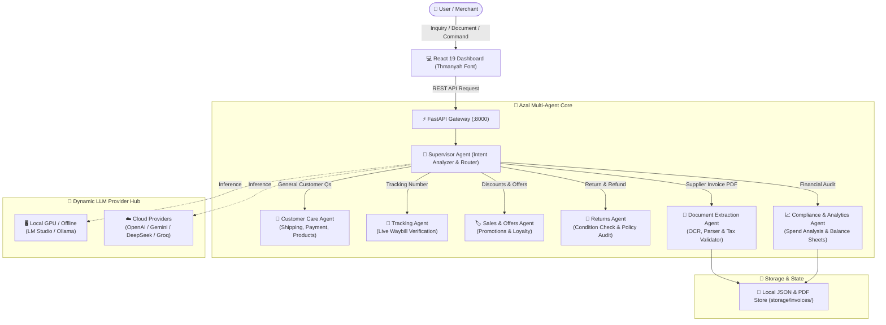
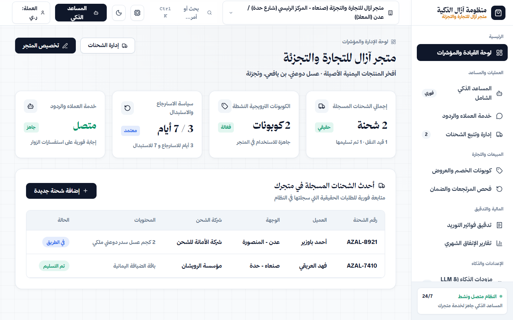
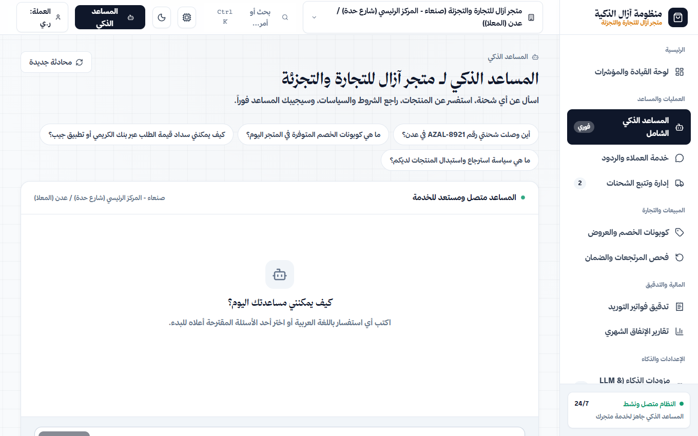
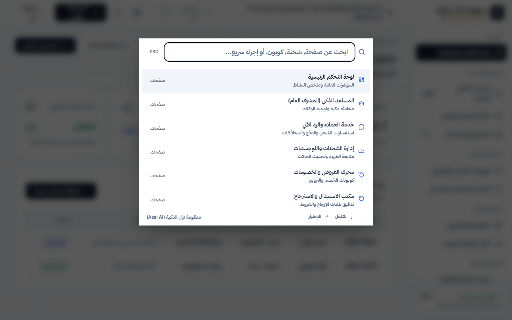
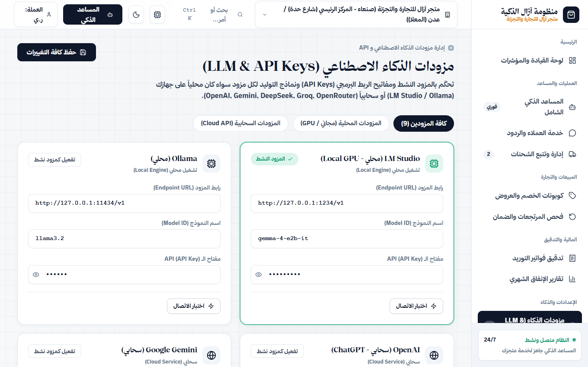
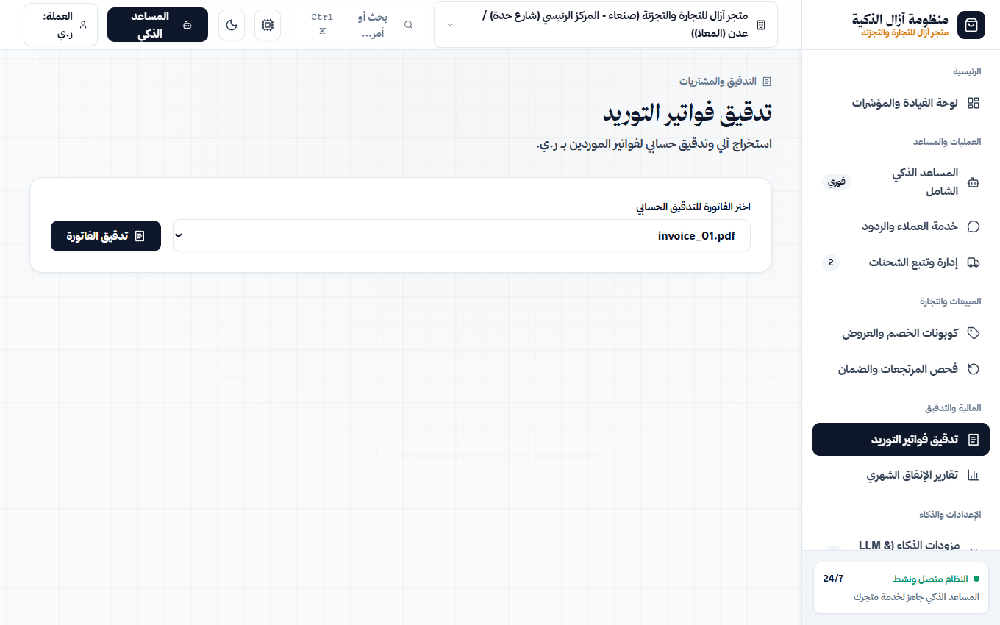
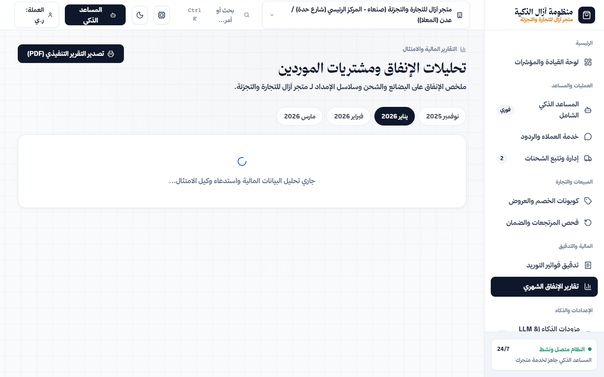

<div align="center">

# ⚡ Azal AI (منظومة آزال الذكية)
### *Autonomous Multi-Agent AI Operating System for E-Commerce & Modern Retail*

[](https://fastapi.tiangolo.com)
[](https://react.dev)
[](https://www.typescriptlang.org)
[](https://vitejs.dev)
[](https://www.python.org)
[](https://lmstudio.ai)
[](LICENSE)

<br/>

**[ 🇸🇦 اقرأ الدليل باللغة العربية ](README.ar.md)** &nbsp;|&nbsp; **[ 📖 Documentation ](#-table-of-contents)** &nbsp;|&nbsp; **[ 🚀 Quickstart ](#-quick-start)** &nbsp;|&nbsp; **[ 🌟 Star this Repo ](https://github.com/alhaj-ai/Azal-AI)**

<br/>

<p align="center">
  <b>Azal AI</b> is a production-grade, enterprise-ready multi-agent AI operating system engineered for e-commerce brands, logistics hubs, and retail merchants. It features intelligent supervisor agent routing, multi-provider LLM support (including <b>100% offline local GPU</b> execution via LM Studio and Ollama), automated supplier invoice auditing, and localized customer support workflows.
</p>

</div>

---

## 📑 Table of Contents
- [🌟 Key Highlights](#-key-highlights)
- [🏗️ Multi-Agent Architecture](#-multi-agent-architecture)
- [⚡ Multi-Provider LLM Hub](#-multi-provider-llm-hub)
- [🖥️ UI & User Experience Showcase](#-ui--user-experience-showcase)
- [📁 Project Structure](#-project-structure)
- [🚀 Quick Start](#-quick-start)
  - [Prerequisites](#prerequisites)
  - [1. Backend Setup (FastAPI)](#1-backend-setup-fastapi)
  - [2. Frontend Setup (React 19 + Vite)](#2-frontend-setup-react-19--vite)
  - [3. Local Offline GPU Execution](#3-local-offline-gpu-execution)
- [⚙️ Configuration & Environment Variables](#-configuration--environment-variables)
- [🧪 Testing & Verification](#-testing--verification)
- [🗺️ Product Roadmap](#-product-roadmap)
- [🤝 Contributing](#-contributing)
- [📄 License](#-license)

---

## 🌟 Key Highlights

- 🧠 **Supervisor Multi-Agent Coordination**: Intelligent intent-routing engine that orchestrates specialized domain agents (Customer Care, Order Tracking, Returns, Document Auditing, and Financial Compliance) with autonomous function calling.
- 🔒 **100% Offline / Zero-Cost Local Inference**: Native integration with **LM Studio** and **Ollama**. Accelerate private open-weights models (`gemma-4-e2b-it`, `llama-3.3-70b`, `qwen-2.5`) directly on consumer GPUs (NVIDIA RTX with CUDA) with zero recurring cloud subscription costs.
- 🔌 **Dynamic Multi-Provider AI Hub**: Seamlessly toggle between 9 LLM providers in real-time from the dashboard (LM Studio, Ollama, OpenAI, Google Gemini, DeepSeek, Groq Cloud, OpenRouter, Mistral AI, or any Custom OpenAI-compatible endpoint).
- 🧾 **Autonomous Invoice & Supply-Chain Auditing**: Ingests supplier PDFs, extracts structured invoice line-items, runs automated tax & arithmetic validations, and flags calculation discrepancies automatically.
- 📊 **Executive Financial & Compliance Analytics**: Aggregates vendor spend, calculates monthly balance sheets, computes month-over-month expenditure deltas, and generates structured executive briefs in natural Arabic.
- 🎨 **Enterprise SaaS UI & Custom Typography**: Built with React 19, TypeScript, and modern dual themes (OLED Dark & Clean Light) with native support for the official **Thmanyah Bold** (`ثمانية عريض`) typography.
- 🌐 **Localized for MENA & Yemeni Commerce**: Native workflows for regional payment methods (Al-Kuraimi, Jeeb, Jawwali, cash on delivery), provincial shipping coverage (all 22 Yemeni governorates), and local retail return policies.

---

## 🏗️ Multi-Agent Architecture



---

## ⚡ Multi-Provider LLM Hub

Azal AI decouples your business logic from LLM vendors. Switch between local private models or hyperscale cloud APIs with a single click:

| Provider | Type | Recommended Model | Best Use Case |
|---|---|---|---|
| **LM Studio** | Local GPU (Offline) | `gemma-4-e2b-it` / `llama-3.2-3b` | 100% Free, Private, Air-gapped deployments |
| **Ollama** | Local CLI (Offline) | `llama3.3:latest` / `qwen2.5:14b` | Self-hosted servers & headless Linux setups |
| **OpenAI** | Cloud | `gpt-4o` / `gpt-4o-mini` | High-complexity multi-step reasoning |
| **Google Gemini** | Cloud | `gemini-1.5-pro` / `gemini-1.5-flash`| Large context analysis & multimodal docs |
| **DeepSeek** | Cloud | `deepseek-chat` / `deepseek-reasoner`| Cost-efficient high-performance math & logic |
| **Groq Cloud** | Cloud | `llama-3.3-70b-versatile` | Ultra-fast token latency (<200ms TTFT) |
| **OpenRouter** | Cloud Aggregator | Any supported open/closed model | Multi-model fallback redundancy |
| **Mistral AI** | Cloud | `mistral-large-latest` | Multilingual European & Arabic precision |

---

## 🖥️ UI & User Experience Showcase

<div align="center">

### 1. Executive Operations Dashboard
*Real-time retail KPIs, live shipments table, promo campaign manager, and dual-theme switch.*
<br/>


<br/><br/>

### 2. Multi-Agent Supervisor Copilot
*Omni-channel intelligent chat routing customer inquiries, tracking lookups, and supplier analysis.*
<br/>


<br/><br/>

### 3. Omni Command Palette (`Ctrl + K`)
*Instant spotlight search and execution across pages, shipments, discount codes, and system settings.*
<br/>


<br/><br/>

### 4. Dynamic Multi-Provider AI Hub (9 Providers)
*Zero-cost offline local GPU (LM Studio / Ollama) + Hyperscale Cloud APIs (OpenAI, Gemini, DeepSeek, Groq).*
<br/>


<br/><br/>

### 5. Automated PDF Invoice Auditor
*Instant PDF ingestion, OCR, line-item table parsing, and automated arithmetic & tax verification.*
<br/>


<br/><br/>

### 6. Executive Financial Compliance & Analytics
*Monthly spend progress charts, top supplier distribution bars, and printable board-ready briefs.*
<br/>


</div>

---

## 📁 Project Structure

```bash
Azal-AI/
├── agents/                      # Multi-Agent Domain Logic
│   ├── supervisor_agent.py      # Master supervisor & intent dispatcher
│   ├── customer_agent.py        # Customer inquiries & retail FAQs
│   ├── document_agent.py        # PDF invoice extraction & arithmetic validator
│   ├── compliance_agent.py      # Financial reporting & vendor analysis
│   └── validate_vat.py          # Commercial tax & VAT compliance logic
├── api/                         # Backend Gateway
│   ├── main.py                  # FastAPI application endpoints
│   ├── llm_manager.py           # Multi-provider LLM connector & config loader
│   └── __init__.py
├── config/                      # System Configurations
│   └── llm_config.json          # Provider presets & active credentials
├── data/                        # Business Domain Knowledge
│   ├── faqs/                    # Customer FAQs (shipping, return policies)
│   ├── policies/                # Terms of service & business rules
│   └── products/                # Product catalog & pricing sheets
├── storage/                     # Local Persistence Engine
│   ├── invoice_store.py         # Local JSON metadata & PDF file manager
│   └── invoices/                # Ingested PDF invoices & parsed records
├── web/                         # Modern Frontend Application
│   ├── src/
│   │   ├── main.tsx             # React 19 unified SPA application
│   │   └── App.css              # Custom styling & Thmanyah typography
│   ├── index.html               # Web root with RTL setup & font imports
│   ├── package.json             # Frontend dependencies
│   └── vite.config.ts           # Vite configuration with proxy
├── .env.example                 # Environment variables blueprint
├── pyproject.toml               # Python project specifications (PEP 621)
├── requirements.txt             # Backend Python dependencies
├── test_storage.py              # Unit tests for storage engine
└── test_aggregates.py           # Unit tests for financial calculations
```

---

## 🚀 Quick Start

### Prerequisites
- **Python**: Version `3.11` or higher installed.
- **Node.js**: Version `18` or higher and `npm`.
- *(Optional for Local AI)*: [LM Studio](https://lmstudio.ai/) or [Ollama](https://ollama.com/) installed with an open-weights model loaded.

---

### 1. Backend Setup (FastAPI)

1. **Clone the repository**:
   ```bash
   git clone https://github.com/alhaj-ai/Azal-AI.git
   cd Azal-AI
   ```

2. **Create a virtual environment & install dependencies**:
   ```bash
   python -m venv .venv
   # On Windows:
   .venv\Scripts\activate
   # On macOS/Linux:
   source .venv/bin/activate

   pip install -r requirements.txt
   ```

3. **Start the FastAPI backend server**:
   ```bash
   python -m uvicorn api.main:app --host 127.0.0.1 --port 8000 --reload
   ```
   *The backend will be running at `http://127.0.0.1:8000` (API documentation available at `/docs`).*

---

### 2. Frontend Setup (React 19 + Vite)

1. **Navigate to the web directory**:
   ```bash
   cd web
   npm install
   ```

2. **Start the Vite development server**:
   ```bash
   npm run dev
   ```
   *Open your browser at `http://127.0.0.1:5173` to access the Azal AI Control Center.*

---

### 3. Local Offline GPU Execution

To run Azal AI 100% locally with zero cloud API keys and complete data privacy:
1. Open **LM Studio**.
2. Download any lightweight chat model (e.g., `google/gemma-2-2b-it` or `meta-llama-3.1-8b-instruct`).
3. Start the Local Server inside LM Studio on port `1234` (`http://127.0.0.1:1234/v1`).
4. In the Azal AI Dashboard, navigate to **مزودات الذكاء (AI Providers)** and select **LM Studio (تشغيل محلي GPU)** as active!

---

### 4. Docker Quickstart (One-Command Deployment)

Run both the FastAPI backend and built React 19 frontend in an isolated container:
```bash
docker compose up -d
```
*Access the unified control center at `http://localhost:8000`.*

---

## ⚙️ Configuration & Environment Variables

Copy the template to create your `.env` file:
```bash
cp .env.example .env
```

| Key | Description | Default |
|---|---|---|
| `ACTIVE_LLM_PROVIDER` | Currently active LLM provider (`lmstudio`, `openai`, `gemini`, etc.) | `lmstudio` |
| `LMSTUDIO_BASE_URL` | Local LM Studio endpoint | `http://127.0.0.1:1234/v1` |
| `LMSTUDIO_MODEL` | Active model identifier in LM Studio | `gemma-4-e2b-it` |
| `OPENAI_API_KEY` | OpenAI API Secret Key (if using OpenAI) | *Optional* |
| `GEMINI_API_KEY` | Google Gemini API Key (if using Gemini) | *Optional* |
| `DEEPSEEK_API_KEY` | DeepSeek API Key (if using DeepSeek) | *Optional* |
| `PORT` | FastAPI backend port | `8000` |

---

## 🧪 Testing & Verification

Run the automated test suite to verify storage engines and financial analytics:

```bash
# Verify local file storage and invoice ingestion
python test_storage.py

# Verify financial aggregations and spend calculations
python test_aggregates.py

# Run frontend production build test
cd web && npm run build
```

---

## 🗺️ Product Roadmap

- [x] Multi-agent supervisor routing engine.
- [x] 100% offline local GPU execution via LM Studio.
- [x] Multi-provider LLM management hub (9 providers).
- [x] Thmanyah Bold typography with Light / Dark OLED themes.
- [x] **Phase 1**: Omni Command Palette (`Ctrl + K`) for instant navigation, search, and shortcuts.
- [x] **Phase 2**: Live Agent Flow Visualizer (real-time step pipeline & latency timer).
- [x] **Phase 3**: Dynamic interactive financial & logistics charts (spend progression & supplier breakdown).
- [x] **Phase 4**: Automated printable shipping waybills (QR & barcode) & executive compliance reports.
- [x] **Phase 5**: Mobile PWA responsive bottom navigation.
- [ ] **Phase 6**: Multimodal voice & speech agent interface via Faster-Whisper.

---

## 🤝 Contributing

Contributions are what make the open-source community such an amazing place to learn, inspire, and create. Any contributions you make are **greatly appreciated**!

1. Fork the Project.
2. Create your Feature Branch (`git checkout -b feature/AmazingFeature`).
3. Commit your Changes (`git commit -m 'feat: Add some AmazingFeature'`).
4. Push to the Branch (`git push origin feature/AmazingFeature`).
5. Open a Pull Request.

Don't forget to give the project a ⭐ if you found it useful!

---

## 📄 License

Distributed under the MIT License. See [`LICENSE`](LICENSE) for more information.

<div align="center">
  <p>Engineered with ❤️ for the modern commerce ecosystem.</p>
</div>
